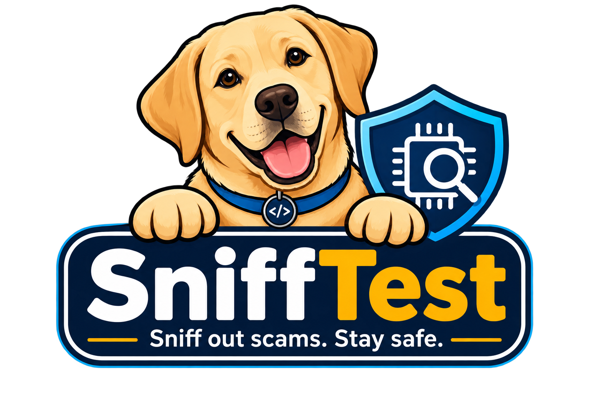

<p align="center"></p>

# 🐶 SniffTest — does it pass the sniff test?

**Local AI scam & manipulation radar.** Paste any suspicious SMS, DM, email, job offer or
listing → instant verdict with probability receipts, explained in 16 languages.
**100% local. No accounts. No cloud. No tracking. Free forever.**

> The only network request this app ever makes is to **your own Ollama** at `127.0.0.1:11434`.
> Open the source — it's one file. There is nothing else to trust.

## How it works (verdict-first architecture)

| Lane | Model | Job |
|---|---|---|
| System 1 | [`nimble`](https://ollama.com/library/nimble) (9B decision model, Bespoke Labs) | One `/v1/systemone` call, 14 typed questions → probabilities. No generation. |
| Fusion | plain JavaScript | Deterministic weighted score 0–100 + floors + guarded lanes → `PASSES / SKETCHY / FAILS`. |
| System 2 | [`lfm3`](https://ollama.com/library/lfm3) (1.7B, Liquid AI, ~1 GB) | Streams a grounded briefing of the **locked** verdict. It may never change it. |

**The verdict is math, not vibes.** Weights (sum = 1.0): scam .22 · phishing .16 · payment .14 ·
pii .10 · impersonation .10 · urgency .08 · too_good .08 · secrecy .06 · links .06.
Final = 70% weighted flags + 15% severity rubric + 15% P(kind=scam).

**Guarded lanes (caps, applied after floors and only under strict gates):**
- **Advisory lane → cap 15.** A warning/report ABOUT scams gets discounted — but only when
  `about_scam ≥ .75` (or kind = advisory) **AND** `reader_action ∈ {protect, nothing}` **AND** no
  credential/payment/PII pressure (≥ .6) and no impersonation (≥ .6). A scam wrapped in warning
  language fails the gates, gets zero discount, and earns a "possible camouflage" note instead.
- **Marketing lane → cap 40.** Aggressive-but-legit marketing (kind = marketing +
  `value_exchange ≥ .6` + no hard signals + `scam < .85`) can never reach FAILS — at worst SKETCHY.
- **Floors (always win over caps):** phishing≥.8 with payment≥.6 or pii≥.7 → 75; scam≥.9 → 70;
  any weighted flag ≥.85 → 45 (dominant signal never diluted).

Questions are reader-directed and contrastive ("warnings about scams are NOT scams", "ordinary
sale deadlines do NOT count") plus two discriminators: `reader_action` (protect vs comply) and
`value_exchange` (real product at a stated price vs money for nothing).

Tiers: <18 PASSES · 18–44 SKETCHY · ≥45 FAILS. All in one `CONFIG`/`PACK` block — tune freely.

**Local learning (per device, no files):** 👍/👎 corrections are stored in capped `localStorage`
(≤300 memories, texts truncated to 1,200 chars, FIFO eviction, duplicates overwrite — ≤ ~400 KB).
Two adaptation layers: case memory (word 3-gram similarity — ≥92% near-duplicate nudges the tier
one step toward your correction; ≥80% adds a note) and bounded calibration ("actually safe" decays
promo flags ×0.9, "actually risky" boosts top flags ×1.1, multipliers clamped to [0.4×, 1.6×]).
Model weights never change; only the deterministic scoring layer adapts. Export/clear/reset live
in Settings.

**Degradation ladder:** nimble+lfm3 → full · nimble only → verdict only · lfm3 only → Lite mode
(badged, less reliable) · Ollama <0.35 → auto-fallback + update hint · nothing → in-app setup guide.

## Use cases

Where SniffTest is most useful:

- **SMS & messaging — the core use case and its strongest result** (F1 .92 on the UCI SMS Spam
  collection). A fast, private second opinion before you reply to, call, or pay anything.
- **Email & phishing** — credential-harvest and lookalike-domain lures (Nazario/CEAS recall
  .75–.89 with near-zero false alarms).
- **Job offers & advance-fee scams** — recruitment and 419/WFH fraud (EMSC-1, Nigerian-419).
  The 419/advance-fee class is essentially solved (F1 1.000).
- **Marketplace / rental / "too good to be true" listings** — urgency + secrecy + payment-pressure
  patterns.
- **Anything that pressures for money, credentials, or PII** — the 14-question decision pack is
  domain-agnostic; specialist packs (recruitment, phishing, financial, social) add targeted signal
  on top.

**A green verdict means "no strong signals found," never "certified safe."** Treat SniffTest as a
fast, private second opinion — not a substitute for verifying through official channels when money
is on the line.

## Benchmarks — how good is it? (v1.4, 2026-11)

SniffTest is scored by a **local-only harness** that extracts the exact `PACK` + `fuse()` scoring
code from the shipped `snifftest-v1.4.html` and judges every row with **`nimble:9b`** through local
Ollama (`/v1/systemone` decision endpoint) — **zero cloud calls**. So the numbers are the *app's*
numbers, not a copy's. Every figure below has a per-row audit trail (full text, receipts, latency).

**Decision rules.** `flagged` = SKETCHY ∪ FAILS (the app raises a flag); `FAILS`-only = the app is
confident. `UNCLEAR` is an abstention and is never counted as a flag.

### Datasets tested (8)

| Dataset | Domain | Rows scored | What it measures |
|---|---|---|---|
| **DIFraUD `phishing`** (primary) | phishing email | 1,526 (test) | Recall + precision on deceptive vs non-deceptive email |
| **DIFraUD `job_scams`** (primary) | job ads | 1,430 (test) | The hardest split — subtle fake job ads |
| **UCI SMS Spam** | SMS | 400 (200/200) | Core use case: SMS spam vs ham |
| **EMSC-1** (fake job postings) | job ads | 500 (250/250) | Real-world advance-fee / WFH job scams |
| **CEAS-08** | phishing email | 397 | Classic phishing corpus |
| **Nazario** | phishing | 200 (scam-only) | Recall on verified real phishing |
| **Nigerian 419** | fraud | 200 (scam-only) | Advance-fee fraud recall |
| **SpamAssassin** | raw email | 387 | spam vs ham (raw email) |
| **Enron (ham)** | legit corporate mail | 200 (ham-only) | False-alarm rate on legitimate mail |

DIFraUD (HuggingFace, MIT) is the **primary** benchmark and is run **exhaustively** on its full
test and validation splits — not sampled. The external datasets are deterministic stratified samples
(seed 42), sized to balance evaluation power against ~1–1.5 s/row of local inference. Full
provenance, licenses, and label-mapping notes live in [`benchmark/datasets/README.md`](benchmark/datasets/README.md).

### Latest scores — v1.4

**DIFraUD test split (held out):**

| Split | flagged P / R / F1 | FAILS P / R / F1 |
|---|---|---|
| phishing (n=1,526) | **.859 / .913 / .885** | .960 / .825 / .888 |
| job_scams (n=1,430) | .113 / .283 / .161 | .268 / .183 / .218 |
| **overall (n=2,956)** | .717 / .856 / **.781** | **.909 / .768 / .833** |

**External suite (7 datasets):**

| Dataset | flagged P / R / F1 | FAILS P / R / F1 |
|---|---|---|
| UCI SMS Spam (n=400) | **.938 / .900 / .918** | .964 / .660 / .783 |
| EMSC-1 job scams (n=500) | .760 / .368 / .496 | .853 / .232 / .365 |
| CEAS-08 (n=397) | .948 / .746 / **.835** | .993 / .690 / .814 |
| Nazario (n=200, scam-only) | 1.000 / .885 / .939 | 1.000 / .755 / .860 |
| Nigerian 419 (n=200, scam-only) | 1.000 / 1.000 / **1.000** | 1.000 / .985 / .992 |
| SpamAssassin (n=387) | .995 / .968 / **.981** | 1.000 / .840 / .913 |
| Enron ham (n=200) | **3 false alarms (1.5%) — 0 confident** | 0 |
| **suite overall (n=2,284)** | .949 / .792 / **.863** | **.981 / .674 / .799** |

### How to read these numbers

- **SMS — the core use case — is where it's strongest:** F1 .918 at .94 precision. This is the
  single biggest real-world win and the case the app is built for.
- **Confident verdicts (FAILS) are high-precision:** overall FAILS precision .91 on DIFraUD and
  .98 on the external suite. When SniffTest is *confident*, it's almost always right.
- **419 / advance-fee fraud is essentially solved** (F1 1.000).
- **Legitimate corporate mail is clean:** 98.5% pass rate on Enron ham, and **zero** confident
  (FAILS) false alarms.
- **The honest weak spot is recall on subtle, professional-looking scams** — especially the
  DIFraUD `job_scams` split, whose deceptive ads are short, subtle, and deliberately close to real
  listings. On the *full* EMSC-1 corpus (real advance-fee scams) the same recruitment pack reaches
  .76 precision / .37 recall — so the pack works; that particular DIFraUD class is just unusually
  hard to separate from genuine ads.

### Version history (same harness, same model)

| Metric | v1.2 | v1.3 | **v1.4 (ship)** |
|---|---|---|---|
| DIFraUD test — flagged F1 | .784 | .766 | **.781** |
| DIFraUD test — flagged recall | .713 | **.862** | .856 |
| DIFraUD test — FAILS F1 | .692 | .832 | **.833** |
| External suite — flagged F1 | .813 | **.866** | .863 |
| External suite — FAILS F1 | .683 | .799 | **.799** |
| Enron ham false alarms | 1/200 | 3/200 | 3/200 |

v1.4 = v1.3's fusion **plus a corroboration gate** (specialist-pack weights only count when a
specialist flag ≥ .70 or a hard common signal corroborates) and a slightly higher SKETCHY bar for
specialist-only cases. On the validation split it kept v1.3's recall (lost 2 of 564 true catches),
removed 20 false positives, and left the confident-FAILS metrics byte-identical — i.e. the gate is
verified safe. It is the best-balanced release: the best overall flagged F1 on DIFraUD plus the
highest FAILS F1, with near-perfect 419 and spam scores.

## Reproducing the benchmarks

Everything needed — the harness, the raw + prepared datasets, per-row audits, and reports — is in
the [`benchmark/`](benchmark/) folder. It's a **zero-dependency Node 18+** harness that reuses the
exact judge code from the shipped HTML.

```bash
cd benchmark
# Primary benchmark — DIFraUD (needs local Ollama + `nimble:9b` running)
node benchmark.js --split test --concurrency 4 --html ../snifftest-v1.4.html --out results-v14
node benchmark.js --split validation --concurrency 4 --html ../snifftest-v1.4.html --out results-v14-val
# External suite (7 datasets)
node benchmark.js --domain sms_spam,emsc1,ceas08,nazario,nigerian_fraud,spamassassin,enron_ham \
     --split test --data data/external --concurrency 4 --html ../snifftest-v1.4.html --out results-v14-external
# Offline comparisons (no model needed)
node compare-val.js   # validation 3-way (v1.2 / v1.3 / v1.4)
node compare.js       # test 2-way + flips + routing breakdown
```

Runs are **resumable** (re-running skips already-scored rows). Outputs:
`<out>/<domain>__<split>.jsonl` (per-row audit trail) and `<out>/scorecard.json` (metrics).
`prepare_external.py` (or `prepare_external.js`) rebuilds the stratified external splits from the
raw corpora in `datasets/` (deterministic, seed 42). `analyze.js` dissects misses offline.

## Try it (visitors)

1. Open the GitHub Pages link.
2. The app walks you through a ~2-minute one-time setup:
    - Install **Ollama 0.35+** from [ollama.com/download](https://ollama.com/download)
      (0.35 introduced the `/v1/systemone` decision endpoint).
    - Allow the page to reach your local Ollama (CORS):
      - Windows: `setx OLLAMA_ORIGINS "*"` → quit & restart Ollama from the tray
      - macOS: `launchctl setenv OLLAMA_ORIGINS "*"` → restart the app
      - Linux: `Environment="OLLAMA_ORIGINS=*"` in the systemd unit → restart
      - Tighter than `*`: use this site's exact origin instead.
    - `ollama pull nimble` (~9.5 GB) and `ollama pull lfm3` (~1 GB)
3. Paste → **Sniff it** → share the verdict card (your message text is never on the card).

**Troubleshooting:** Safari may block `http://localhost` from an HTTPS page — use
Chrome/Edge/Firefox, or download `snifftest-v1.4.html` and open it directly (works from disk).

## Run / fork it (developers)

It's one static file. `git clone` → open **`snifftest-v1.4.html`**, or serve any way you like.
No build step, no dependencies, no package.json. Host free on GitHub Pages
(Settings → Pages → deploy from `main`, root). The `index.html` inside `benchmark/` is a
self-contained snapshot used for benchmarking; **`snifftest-v1.4.html` at the repo root is the
release you ship.**

**Extension point:** question packs are data (`PACK`). A ToS scanner, rental-listing radar, or
dark-pattern detector is a new pack — the engine, dial, and share card are generic. PRs welcome.

## Honest limitations

- **Probabilities are model estimates, not calibrated guarantees** (per Bespoke Labs' own notes).
- **Subtle professional scams can slip through.** Recall is the honest weak spot, especially on
  DIFraUD `job_scams` and short, well-crafted phishing. A green verdict is "no strong signals,"
  not a safety certificate.
- **Spam ≠ scam.** Spam-labeled classes (SMS spam, SpamAssassin) include ordinary commercial mail;
  SniffTest treats aggressive-but-legit marketing as SKETCHY-at-worst, so measured precision on
  those sets is a **lower bound**.
- **Nimble ships ~8K context** on Ollama; inputs are trimmed to fit. A handful of very long rows
  are rejected (HTTP 500, ≤0.9% of any set) and excluded from metrics. Score/rubric outputs are
  nimble's weakest mode, so the fusion weights them lightly.
- **Enron ham is 2000s-era corporate mail.** Modern legit messaging (Slack-style, calendar invites)
  is underrepresented in every public set we scored.
- **Single model, single machine.** All evaluations ran on one `nimble:9b` via local Ollama;
  cross-model variance is untested.
- **AI guidance only** — not legal, financial, or security advice. When money is on the line,
  verify through official channels.

## Privacy manifest

- Network: your Ollama only. No CDN, no fonts, no analytics, no telemetry, no external images.
- Storage: `localStorage` holds endpoint + model choices only. Your pasted text is never stored —
  except when you explicitly click 👍/👎 feedback (that click is the consent): capped, local-only
  case memory (≤300 truncated memories) that powers per-device adaptation. Export is an optional
  one-time button in Settings; nothing is ever sent anywhere.
- Share cards contain the score and flag percentages — never your message.

## Repository layout

- `snifftest-v1.4.html` — the app (one self-contained file, logo inlined).
- `logo.png`, `README.md` — brand + docs.
- `benchmark/` — everything used to *measure* the app:
  - `benchmark.js`, `compare.js`, `compare-val.js`, `analyze.js` — zero-dependency harness & comparisons
  - `prepare_external.py` / `.js` — rebuilds the stratified external splits
  - `datasets/` — raw benchmark corpora + provenance/licenses (`datasets/README.md`)
  - `data/` — prepared DIFraUD + external splits (`data/external/`)
  - `results*/` — per-row audit trails + `scorecard.json` per run/version
  - `COMPREHENSIVE_BENCHMARK_REPORT.md`, `EVALUATION_PLAN.md` — full v1.2/v1.3/v1.4 write-up

## Licenses (app ≠ models)

| Component | License |
|---|---|
| SniffTest app code | MIT (`LICENSE`) |
| nimble weights | Apache-2.0 |
| LFM3 weights | LFM Open License v1.0 |

You pull models yourself from Ollama; this repo redistributes no weights.
